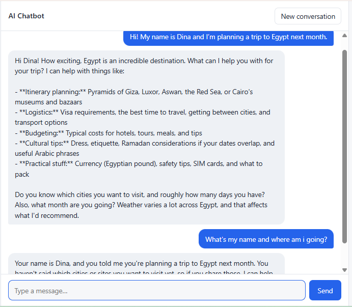

# AI Chatbot Prototype

A clean, minimal chatbot built with **Python, FastAPI** and an LLM API (**Claude** or **OpenAI**). It keeps conversation context, streams replies word by word, handles errors gracefully, and includes an automated test suite.



## Features

- Simple chat interface (plain HTML/JS, no build step), works on desktop and mobile
- Claude or OpenAI, switchable with one setting
- Conversation history per session, trimmed to keep requests fast and affordable
- Configurable system prompt (`system_prompt.txt`)
- Streaming responses via Server-Sent Events
- "New conversation" reset button
- Error handling: API failures show a friendly message and the failed turn isn't saved, so the user can just retry
- Input validation (empty and overly long messages are rejected)
- Automated tests that run without an API key

## Quick start

```bash
python -m venv .venv
# Windows: .venv\Scripts\activate    macOS/Linux: source .venv/bin/activate
pip install -r requirements.txt

cp .env.example .env        # Windows: copy .env.example .env
# open .env and add your ANTHROPIC_API_KEY (or set LLM_PROVIDER=openai and add OPENAI_API_KEY)

uvicorn app:app --reload
```

Open http://localhost:8000 and start chatting.

## Run the tests

```bash
pytest
```

The tests replace the LLM with a fake provider, so they're fast, free and need no network. They cover streaming, conversation memory, session isolation, reset, API failure recovery, input validation and history trimming.

## How it works

| Piece | File | Notes |
|---|---|---|
| API server | `app.py` | `POST /api/chat` (streams the reply), `POST /api/reset`, `GET /api/health` |
| LLM providers | `providers.py` | One small class per provider, same `stream()` interface |
| Conversation memory | `store.py` | In-memory, one history per session ID |
| Chat page | `static/index.html` | Reads the event stream and renders text as it arrives |

**Conversation context.** Each browser tab gets a random session ID. The server keeps that session's messages and sends the recent ones with every request, so the model remembers earlier turns. History is capped (`MAX_HISTORY_MESSAGES`, default 20) and always starts with a user message, which keeps token costs predictable. A turn is saved only after the reply finishes successfully.

**Streaming.** The server forwards the model's output as Server-Sent Events (`token`, `done`, `error`). Because errors are events too, a failure halfway through a reply still reaches the user cleanly.

**Security.** The API key stays on the server and is never sent to the browser. Model output is inserted as plain text, never as HTML.

## Limitations and next steps

This is a prototype, so a few things are deliberately left out:

- History lives in memory and is cleared when the server restarts. Swap `ConversationStore` for Redis or a database to persist it.
- No authentication or rate limiting yet. Add both before exposing it publicly.
- For long conversations, older turns could be summarised instead of dropped.
- Markdown rendering for replies (with sanitising) would improve formatting.
